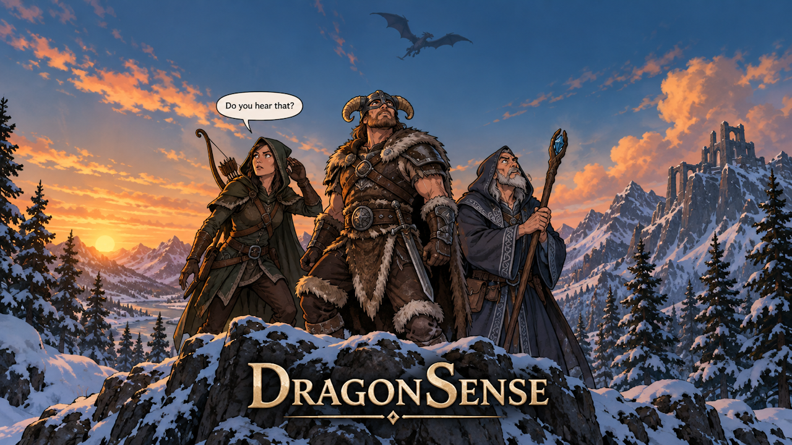

# DragonSense



Gives SkyrimNet NPCs ears for things typically only perceived by the player.

Two things, so far:

- **Dragon roars.** The plugin watches the dragon flight-roar sound records, ignores kill and resurrection roars, and raises a DragonSense event when one plays. A dragon in combat is always classified near; otherwise within 2,000 units is near and anything further is distant.
- **The Greybeards' summons.** Watched from `MQGreybeardCall`'s startup stage, so it narrates when the shout actually plays rather than when the quest ends.

Each roar episode is a coin flip: half become a stored event the NPCs can remember later, half become an authored narration that provokes a reaction now.

One mod, one archive: the SKSE plugin plus its SkyrimNet content plugin, which SkyrimNet picks up as an external layer. No ESP.

## Requirements

- Skyrim Special Edition / Anniversary Edition (1.6.x) and SKSE64
- [Address Library for SKSE Plugins](https://www.nexusmods.com/skyrimspecialedition/mods/32444)
- [SkyrimNet](https://www.nexusmods.com/skyrimspecialedition/mods/108752) 0.25 or newer

## Download and install

[Latest release](https://github.com/nan0bug00/DragonSense/releases/latest) — one archive.

Install it with your mod manager and enable it. That's everything: the DLL and the plugin travel together, and SkyrimNet registers the plugin on start-up with an **External** badge on its Installed Plugins page.

The Hub entry for DragonSense is a listing that links here, since the download has to carry the DLL.

## Languages

English is included and is the default. The other twelve are separate SkyrimNet content plugins published on the Hub — install one from the Plugins page:

Russian, Japanese, Portuguese, Spanish, French, German, Italian, Polish, Korean, Vietnamese, Chinese (Simplified), Chinese (Traditional).

A translation replaces the English text, so enable it and disable the English external plugin the mod installs; only one should be active.

## Building

Requires Visual Studio's C++ build tools, CMake and vcpkg.

```
git clone -b ng https://github.com/alandtse/CommonLibVR.git lib/commonlibsse-ng
cmake --preset default
cmake --build build
```

The CommonLibSSE-NG checkout is not committed; clone it into `lib/` as shown. `scripts/deploy.ps1` copies the built DLL and the English plugin into an MO2 instance for testing.

## Layout

- `src/` — the SKSE plugin.
- `plugins/<language>/` — SkyrimNet content plugins. `en` is the one packaged into the mod; the rest are published to the Hub.

## Credit

The event-type registration pattern — dispatching `SkyrimNetApi.RegisterEventSchema` through the Papyrus VM, on save load, with `RE::MakeFunctionArguments` — was copied from [AgencyEngine](https://github.com/cleanestpoison/AgencyEngine) by cleanestpoison. Thank you.

## License

MIT. See `LICENSE`.
